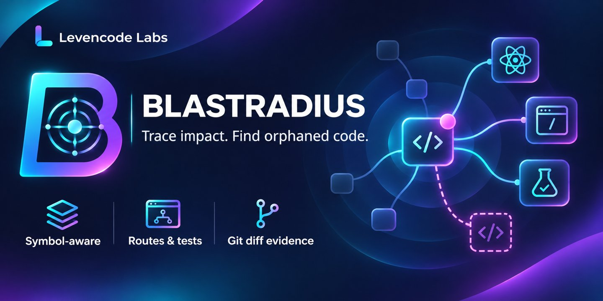

<div align="center">



# BlastRadius

**Know what a change can hit. Find what it leaves behind.**

Local impact analysis · Git differential orphan detection · CLI + MCP + Agent Skill

[Русский](README.ru.md) · [Architecture](docs/ARCHITECTURE.md) · [MCP setup](docs/MCP_SETUP.md) · [Requirements](docs/TECHNICAL_SPEC.ru.md) · [Roadmap](docs/ROADMAP.md)

</div>

> **Development preview (0.0.1-dev), not a v0.1.0 release.** The original 30 goldens and live official MCP SDK stdio have passed hosted CI, with additional pinned public-source regressions and a separate first-score independent corpus. Test counts and the exact SHA gates are recorded in [Acceptance](docs/ACCEPTANCE.md); do not infer graph completeness from a green scoped oracle. A frozen npm v3 lock, provenance/license metadata check and repeatable packed-consumer smoke are now tracked by [P1](docs/P1_SUPPLY_CHAIN.md). Real-project accuracy, complete TypeChecker semantics and license-text/NOTICE sign-off remain open. Never auto-delete orphan findings.

BlastRadius helps coding agents and developers answer two questions **before and after a refactor**:

1. *Impact*: Which imported symbols, components, routes and tests may be affected if this exported function or file changes?
2. *Differential dead code*: After a Git change, which exports became unreachable from known production entry points, and which consumers now refer to missing code?

It builds a local dependency graph based on TypeScript syntax and module resolution. It distinguishes a declaration from an export binding, an imported name from an actual reference, and a test/story from production use. Results include graph-derived evidence and explicit limitations rather than invented confidence scores.

## Quick start from source

Prerequisites: **Node.js 22.13+** and npm, a Git working tree for differential analysis. The project is not published to npm yet.

```sh
git clone https://github.com/levencode-labs/blastradius.git
cd blastradius
npm ci --ignore-scripts --no-audit --no-fund
npm run build
node dist/packages/cli/src/main.js --help
```

> This repository contains a **development preview**, not a release candidate. Installation from source is for evaluation; no npm release has been published.

Against a separate TypeScript/React workspace:

```sh
node dist/packages/cli/src/main.js index --root /absolute/path/to/my-app --json
node dist/packages/cli/src/main.js impact src/hooks/useAuth.ts#useAuth --root /absolute/path/to/my-app --json
node dist/packages/cli/src/main.js diff --base HEAD --root /absolute/path/to/my-app --json
node dist/packages/cli/src/main.js explain --id F001 --root /absolute/path/to/my-app --json
```

On Windows, use a full `C:\...` path with `--root`. Paths inside impact selectors are **relative to that root**. `init` creates an optional `blastradius.config.json`; it refuses to overwrite an existing one. Add `.blastradius/` to the inspected project's `.gitignore`.

### Connect to an MCP coding agent

The server uses **stdio** and the official TypeScript MCP SDK and exposes the same core as the CLI. See [MCP setup](docs/MCP_SETUP.md) for Codex, Claude Code and Cursor examples. Example request:

```json
{"target":{"file":"src/hooks/useAuth.ts","symbol":"useAuth"},"changeKind":"signature","limit":20}
```

Five tools are declared: `br_status`, `br_resolve_symbol`, `br_impact`, `br_analyze_diff`, `br_explain`. The official SDK stdio handshake test is included in `tests/protocol/mcp-stdio.test.mjs` and is mandatory in every CI matrix cell. Hosted [8-cell CI on P2 main](https://github.com/levencode-labs/blastradius/actions/runs/45003627005) verified the official SDK initialize/list/call/error/close workflow, including Windows 22/24. This does not imply complete compatibility with every MCP client.

## Key behavior

- **Export-specific reachability.** `export * from './utils'` is not evidence that every symbol in `utils` is used. A reference to `foo` must not keep unrelated `bar` alive.
- **Differential by default.** `HEAD` → working tree detects newly unreachable exports even when their source files were not edited; staged/index snapshots are supported.
- **Separate root categories.** A reference from Storybook or tests does not make an export live in production. Published package entry points are protected from blanket deletion advice.
- **Evidence, not guesses.** Findings include code, paths, reason codes and a pre-change dependency chain with source locations. Unsupported dynamic access results in incomplete coverage.
- **Local by design.** Static AST processing, Git object reads and SQLite cache only. No cloud service, telemetry, source evaluation or auto-delete.

## Illustrative demo

The [legacy demo](fixtures/legacy-demo) has an `/legacy` Next-style route, `LegacyChart`, `useLegacyData`, a test and a Storybook-only component. On deleting the route:

```text
NEW_ORPHAN_EXPORT  LegacyChart     no remaining production entry point
NOW_TEST_ONLY      useLegacyData    test references still exist
```

These are not proof that either declaration can safely be deleted. External consumers, runtime registries and side effects still require review. The tool can explain the old route → component → hook chain, not claim that it executed a test.

### Independent public-source evaluation

The historical [three-project accuracy study](docs/evidence/P2_PUBLIC_ACCURACY.md) found 13 missed bindings and fixed them. A later **15-repository source-pinned evaluation** on the first-score P7 SHA `b9b53cc053bf0978c50d86a463ddcdc8d677ec1b` measured **70 TP, 46 TN, 0 FP/FN among 116 independently annotated references**, and **8749 TP, 30 TN, 0 FP/FN among 8779 compiler-resolvable named-import pairs**; the 18 P7 labels were frozen in a separate earlier commit. P7 alone had **5310 external or unresolved imports out of 10124 attempted** and all three entire graphs were incomplete. The complete 15-repo evaluation remains a *curated static subset*, not a representative precision/recall estimate or code-deletion authorization. See [P7 evidence](docs/evidence/P7_FIRST_SCORE.md) and [UNKNOWN boundaries](docs/evidence/P2_REMAINING_UNKNOWN.md).

## Implementation status

| Area | Development preview | Remaining for v0.1.0 |
| --- | --- | --- |
| TypeScript AST, static imports, exports, barrels | Basic graph and resolution implemented | Compiler-backed semantic identity, ambiguity and more workspaces |
| React and Next.js | JSX references/props and App/Pages route patterns | Advanced HOCs, redirects, special routes, richer prop spreads |
| Git differential orphan analysis | HEAD/index/worktree, broken references, affected route/test summary and test/story classification | Git rename identity, complex public API/side-effect cases |
| SQLite | Persistent graphs, file facts, transactional writes and symlink protection; source-backed SQLite lock classification regression in PR #23 | More concurrent process modes, cancellation/crash recovery and migration matrix |
| CLI | Core commands with JSON | Full pagination and stricter input contracts |
| MCP and Skill | Five input-validated tools, snapshot-bound explain and agent Skill; official SDK stdio PASS in all 8 CI cells | Additional clients/resources, formal response contract and integration breadth |
| Acceptance | 30 golden fixtures, official SDK CI, 15 SHA-pinned public-source evaluation with explicit UNKNOWN; 5k/50k repeated synthetic profiles from a separate exact PR SHA | Real monorepo repeated p50/p95, complete graph coverage boundaries, independent post-change untouched holdout, legal review, v0.1.0 release decision |

The full [requirements and acceptance matrix](docs/ACCEPTANCE.md) distinguishes tests that ran locally from targets and unverified behaviors.

Development notes and local evidence are in [Implementation update](docs/IMPLEMENTATION_UPDATE_2026-11-22.md) and [Publication and CI status](docs/PUBLICATION_STATUS.md). The 30 goldens and prior hosted CI have been verified. P1 separately checks frozen `npm ci`, installed dependency licenses and a real tarball consumer smoke; see the evidence and remaining gates in [P1 supply-chain notes](docs/P1_SUPPLY_CHAIN.md). `index --force` reparses all source facts; `git.includeUntracked` controls worktree scanning.

## Design and safety

The graph is `consumer → provider`. Reverse graph traversal yields potential impact; forward reachability from production/test/story/public-API roots determines orphan candidates. Type-only references and side-effect imports are treated differently. The tool never declares an unknown runtime dependency safe to remove.

Read [architecture](docs/ARCHITECTURE.md), [known limitations](docs/ACCEPTANCE.md), [security boundaries](docs/SECURITY.md), and [contributor invariants](AGENTS.md) before expanding the analyzer. This preview intentionally retains `private: true` to prevent publishing an unaccepted release.

## License

First-party source: MIT. Review all transitive dependency licenses and run the cross-platform package acceptance before the first public npm release.
