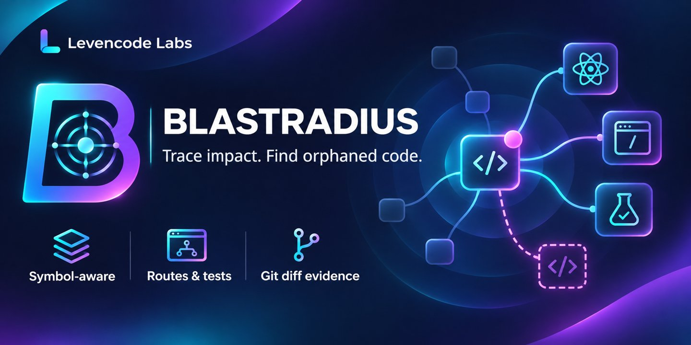

<div align="center">



</div>

# BlastRadius

**Пойми последствия изменения. Найди код, который оно оставило без потребителей.**

[English](README.md) · [Архитектура](docs/ARCHITECTURE.md) · [Настройка MCP](docs/MCP_SETUP.md) · [Полное ТЗ](docs/TECHNICAL_SPEC.ru.md)

> **Предварительная версия разработки, не релиз v0.1.0.** Подготовлены исходники, CLI, заготовка MCP/Skill и локальные тесты. Не все требования и приёмочные проверки из ТЗ завершены. Инструмент не должен автоматически удалять найденный код.

BlastRadius — локальный анализатор для TypeScript, JavaScript, React и Next.js. Он отвечает на два вопроса: какие компоненты, роуты и тесты **потенциально** затронет изменение и какие экспорты стали недостижимыми **именно после текущего изменения**. Работа с кодом остаётся на машине разработчика, в облако ничего не отправляется.

## Как попробовать

Требуется Node.js 22.13+ и установленный npm. Репозиторий [levencode-labs/blastradius](https://github.com/levencode-labs/blastradius) публичный, но это **предварительная версия разработки**, а не релиз npm.

```sh
git clone https://github.com/levencode-labs/blastradius.git
cd blastradius
npm ci --ignore-scripts --no-audit --no-fund
npm run build
node dist/packages/cli/src/main.js index --root /absolute/path/to/project --json
node dist/packages/cli/src/main.js impact src/hooks/useAuth.ts#useAuth --root /absolute/path/to/project --json
node dist/packages/cli/src/main.js diff --base HEAD --root /absolute/path/to/project --json
```

`--root` — абсолютный путь до исследуемого проекта. Селектор файла внутри `impact` — относительный. По умолчанию Git diff сравнивает `HEAD` и рабочее дерево, включая незакоммиченные tracked/untracked файлы; с `--staged` используется Git index. Для повторного объяснения находки `F001` вызовите `explain --id F001` после `diff`.

`init` создаёт `blastradius.config.json`, не перезаписывая существующий файл. Добавьте `.blastradius/` в `.gitignore` проекта. Актуальные примеры подключения к Codex, Claude Code и Cursor — в [MCP_SETUP.md](docs/MCP_SETUP.md).

## Чем полезен агенту

**Перед изменением:** агент вызывает `br_impact`, изучает реальных потребителей, затронутые экраны и связанные тесты. При необходимости `br_resolve_symbol` уточняет символ.

**После изменения:** `br_analyze_diff` ищет новые осиротевшие экспорты, поломанные ссылки и случаи `NOW_TEST_ONLY`/`NOW_STORY_ONLY`. `br_explain` показывает цепочку из графа, почему символ был достижим до изменения.

**При неизвестных связях:** динамические импорты, spread-пропсы, публичный API, потенциальные побочные эффекты и неполная индексация запрещают безусловную рекомендацию удаления. `verified` означает подтверждённую статическую связь в поддерживаемой модели, а не гарантию runtime-безопасности.

## Текущий статус

Основной граф TS/JS, CLI, MCP и Skill доступны в исходниках. **30 формальных golden-сценариев и реальный MCP stdio** подтверждены в CI Linux/Windows/macOS на Node 22/24. Последняя независимая выборка из 15 Git-SHA-закреплённых репозиториев дала 70 TP / 46 TN по 116 ручным меткам и 8749 TP / 30 TN по 8779 разрешимым TypeScript-связям, без наблюдаемых FP/FN в этом ограниченном наборе. Однако все сложные графы могут оставаться неполными, а только в P7 **5310 из 10124** попыток импортов не вошли в проверяемую область. Это не разрешение удалять код автоматически. [P1](docs/P1_SUPPLY_CHAIN.md) добавляет зафиксированный `package-lock.json`, неизменяемый `npm ci`, проверку лицензий зависимостей и реальную сборку/установку npm-архива. Остаются независимые измерения точности на реальных проектах, сложная семантика TypeChecker, проверка юридических текстов лицензий и релизная приёмка; автоматически удалять найденный код нельзя.

## Лицензия

Исходный код проекта — MIT; перед публикацией npm нужна проверка всех зависимостей и платформ.

## Проверяемые границы и скорость

Подробные [итоги P7 и приёмочные ограничения](docs/ACCEPTANCE.md) показывают, что наличие `UNKNOWN` не означает отсутствие зависимостей. Сложные React HOC/spread, динамический React Router, `side effects` и условные package exports нельзя превращать в гарантированно безопасное удаление. Выполнены отдельные синтетические измерения **5000 × 3** и **50000 × 3** файлов (p50/p95 времени и RSS), но повторяемость на реальных монорепозиториях и полный audit/NOTICE ещё открыты. Подключение к OpenCode V2 в режиме stdio описано в [MCP_SETUP.md](docs/MCP_SETUP.md); настоящая интеграция с его установленным Desktop-клиентом отдельно не подтверждена.
